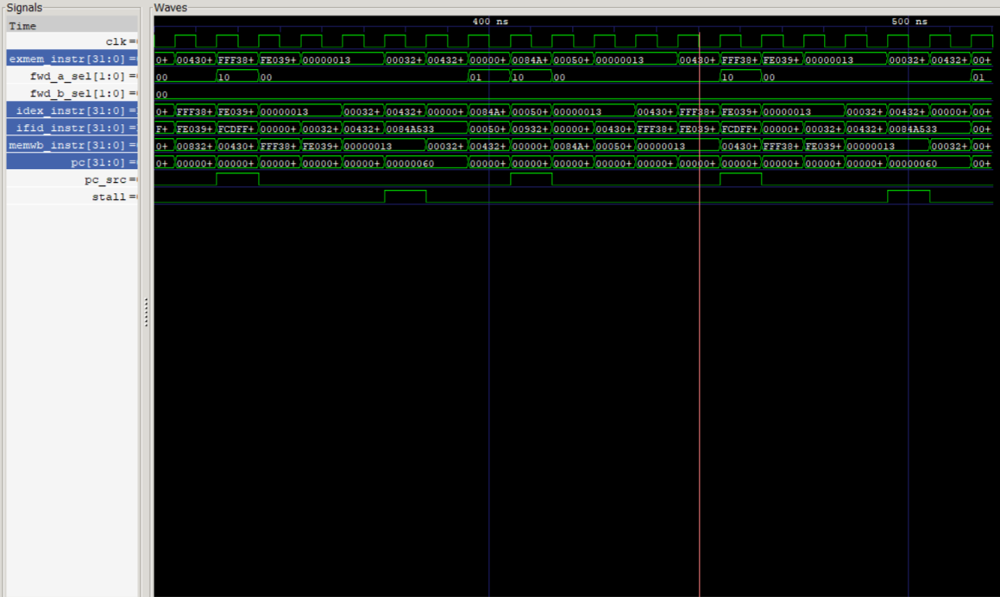

# CPU From Scratch

A 32-bit, 5-stage pipelined CPU written in Verilog, built from the gates up: ALU, register file, memories, control unit, then a single-cycle CPU, then a pipeline with hazard handling. It runs real programs, including a bubble sort.

Built for **Sankalp Techno Feast, NIST University** by Siba Prasad Bhuyan (B.Tech CSE AI/ML).



*The pipeline running bubble sort: instructions moving through the stages, `stall` pulsing on load-use, `pc_src` pulsing on taken branches, and `fwd_a_sel` showing forwarded values.*

## What it does

- **ISA:** a RISC-V RV32I subset: `add sub and or slt addi lw sw beq bne jal`
- **5-stage pipeline:** IF, ID, EX, MEM, WB, with IF/ID, ID/EX, EX/MEM and MEM/WB pipeline registers
- **Forwarding:** results go straight from EX/MEM or WB back into the ALU, so dependent instructions don't wait
- **Hazard detection:** a load followed immediately by its user stalls the pipeline for 1 cycle
- **Branch handling:** taken `beq`, `bne` and `jal` flush the 2 wrong-path instructions
- **Harvard architecture:** separate instruction and data memories (256 words each)

## Results

| Program | Cycles | Instructions | CPI | Stalls | Branch flushes |
|---|---|---|---|---|---|
| Bubble sort (8 numbers) | 404 | 277 | 1.45 | 28 | 44 |
| Fibonacci (first 10) | 104 | 75 | 1.38 | 0 | 9 |

Bubble sort turns `5 2 9 1 7 3 8 4` into `1 2 3 4 5 7 8 9`. Both programs run on the same hardware; only the `.hex` file changes.

## How the pipeline works

```
 IF  ->  ID  ->  EX  ->  MEM  ->  WB
fetch   decode  ALU    data     write
        + regs         memory   back
```

| Problem | Solution | File |
|---|---|---|
| Instruction needs a result that isn't written back yet | Forwarding from EX/MEM or WB | `rtl/forwarding_unit.v` |
| Instruction needs a loaded value that isn't ready | Stall 1 cycle (bubble into EX) | `rtl/hazard_unit.v` |
| Branch/jump decided in EX, 2 wrong instructions already fetched | Flush IF/ID and ID/EX | `rtl/cpu_pipeline.v` |

## Project layout

```
rtl/        Verilog source: ALU, register file, memories, control, pipeline
testbench/  one self-checking testbench per module / program
programs/   machine code (.hex) for the demos and tests
scripts/    run_all.bat: runs every testbench
docs/       waveform screenshot
```

## Run it

You need [Icarus Verilog](https://bleyer.org/icarus/) and (optionally) GTKWave.

Run every testbench:

```
scripts\run_all.bat
```

Run the bubble sort and look at the waveform:

```
iverilog -o simulation\bs.vvp rtl\adder.v rtl\alu.v rtl\alu_control.v rtl\control_unit.v rtl\data_memory.v rtl\imm_gen.v rtl\instruction_memory.v rtl\mux2.v rtl\program_counter.v rtl\register_file.v rtl\hazard_unit.v rtl\forwarding_unit.v rtl\cpu_pipeline.v testbench\bubble_sort_tb.v
vvp simulation\bs.vvp
gtkwave simulation\bubble_sort.vcd
```

Expected: the sorted array in memory, `cycles = 404`, `CPI = 1.45`, `ALL TESTS PASSED`.

To run your own program, write the instructions as hex words in `programs/yourprogram.hex` and point the testbench's `PROGRAM_FILE` at it.

## Build history

The project was built in 16 phases, one commit each: building blocks (Phases 1-7), single-cycle CPU (8-9), pipeline (10-11), hazards (12), forwarding (13), branches (14), bubble sort (15), integration (16). See `git log`.

## Not implemented

No multiply, shifts, `xor`, `lui` or `jalr`, and no caches or interrupts. It's a teaching CPU, not a full RV32I core.